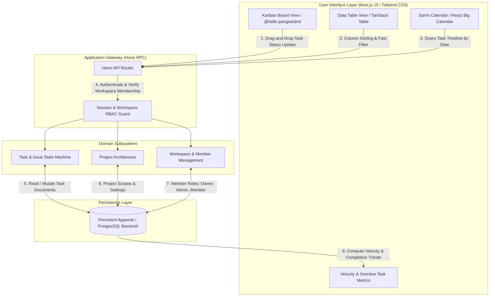

<div align="center">

# GNTI | Track

<p><strong>Project Management Platform with Drag-and-Drop Kanban Boards, Issue Tracking, Sprints & Team Workspaces</strong></p>

<p>A flagship production foundation engineered by <a href="https://gnti.tech">Galaxy Nova Technologies & Innovations (GNTI)</a>.</p>

<p>
  <a href="https://gnti.tech"></a>&nbsp;
  <a href="https://github.com/GNTI-X/track"></a>&nbsp;
  <a href="./LICENSE"></a>&nbsp;
  <a href="https://gnti.tech/projects/track"></a>
</p>

</div>

---

## 📌 1. System Overview

**Track** is an enterprise-grade project management and issue-tracking platform built for high-velocity software engineering teams. Inspired by the depth of Jira and the speed of modern tools, Track offers flexible project organization across drag-and-drop Kanban boards, customizable sprint planning, filterable data tables, and interactive calendar scheduling.

The application features workspace-level multi-tenancy with granular role-based access control (RBAC), allowing organizations to invite team members via secure join codes, partition projects, assign tasks with strict deadlines and priority tiers, and observe team velocity through real-time analytics.

---

## 🏛 2. Architecture & System Flow

### System Architecture Diagram



### End-to-End Workflow

1. **Workspace Provisioning & Team Access**:
   - Users create workspaces or join existing ones using a 6-character workspace invite code.
   - Permissions are evaluated on every request (e.g. Workspace Owners can delete projects, while standard Members can create and move tasks).
2. **Task Creation & Metadata Tagging**:
   - Issues include rich markdown descriptions, assignees, project associations, priority tags (`LOW`, `MEDIUM`, `HIGH`, `URGENT`), and due dates.
3. **Interactive Multi-View Switching**:
   - **Kanban View**: Columns represent task status (`BACKLOG`, `TODO`, `IN_PROGRESS`, `IN_REVIEW`, `DONE`). Moving cards invokes optimistic UI updates powered by `@hello-pangea/dnd`.
   - **Table View**: Paginated view for bulk management with TanStack Table.
   - **Calendar View**: Visual scheduling using `react-big-calendar`.
4. **Analytics & Performance Tracking**:
   - Real-time analytics cards compute overdue task counts, completion velocity, and individual contributor workloads.

---

## 🛠 3. Categorized Tech Stack

| Domain | Technology | Purpose |
|:---|:---|:---|
| **Frontend Framework** | `Next.js 15` & `React 19` | High-performance responsive dashboard with optimistic state |
| **Kanban Engine** | `@hello-pangea/dnd` | Accessible, smooth drag-and-drop board interactions |
| **Tables & Calendars** | `TanStack Table`, `React Big Calendar` | Rich data tables and sprint timeline visualizations |
| **API Framework** | `Hono` | Type-safe internal RPC API routing |
| **Data Fetching** | `TanStack Query (React Query)` | Client-side query caching, deduplication, and optimistic mutations |
| **Persistence** | `Appwrite` / `PostgreSQL` | Document-level database, user authentication, and storage |
| **Styling** | `Tailwind CSS`, `Radix UI`, `Lucide Icons` | Clean enterprise interface with dark/light mode support |

---

## 🗄 4. Domain Data Model & Entity Relationships

- **`workspaces`**:
  - `id`: unique workspace identifier
  - `name`: string
  - `userId`: owner ID
  - `inviteCode`: unique alphanumeric string
- **`members`**:
  - `id`: string
  - `userId`: user identifier
  - `workspaceId`: FK referencing `workspaces`
  - `role`: Enum (`ADMIN`, `MEMBER`)
- **`projects`**:
  - `id`: string
  - `name`: string
  - `imageUrl`: string
  - `workspaceId`: FK referencing `workspaces`
- **`tasks`**:
  - `id`: string
  - `name`: title of the task
  - `workspaceId`, `projectId`: foreign keys
  - `assigneeId`: member assigned to task
  - `status`: Enum (`BACKLOG`, `TODO`, `IN_PROGRESS`, `IN_REVIEW`, `DONE`)
  - `priority`: Enum (`LOW`, `MEDIUM`, `HIGH`, `URGENT`)
  - `dueDate`: ISO date string
  - `position`: integer index for board order

---

## 🔑 5. Environment Variables Reference

| Variable | Required | Description |
|:---|:---:|:---|
| `NEXT_PUBLIC_APP_URL` | **Yes** | Web application origin URL (`http://localhost:3000`) |
| `NEXT_PUBLIC_APPWRITE_ENDPOINT` | **Yes** | Appwrite API endpoint |
| `NEXT_PUBLIC_APPWRITE_PROJECT` | **Yes** | Appwrite project identifier |
| `NEXT_APPWRITE_KEY` | **Yes** | Appwrite backend administrative API key |
| `NEXT_PUBLIC_APPWRITE_DATABASE_ID` | **Yes** | Database ID holding collections |
| `NEXT_PUBLIC_APPWRITE_WORKSPACES_ID`| **Yes** | Workspaces collection ID |
| `NEXT_PUBLIC_APPWRITE_MEMBERS_ID` | **Yes** | Members collection ID |
| `NEXT_PUBLIC_APPWRITE_PROJECTS_ID`| **Yes** | Projects collection ID |
| `NEXT_PUBLIC_APPWRITE_TASKS_ID` | **Yes** | Tasks collection ID |

---

## 🚀 6. Local Development & Deployment

```bash
# 1. Clone repository
git clone https://github.com/GNTI-X/track.git
cd track

# 2. Configure environment
cp .env.example .env

# 3. Install dependencies
npm install

# 4. Run Development Server
npm run dev
```

---

## 🏢 About GNTI

Galaxy Nova Technologies & Innovations (GNTI) builds and deploys scalable software across multi-tenant SaaS, real-time communication, AI automation, and media streaming infrastructure.

- **Website**: [gnti.tech](https://gnti.tech)
- **Official Specification**: [gnti.tech/projects/track](https://gnti.tech/projects/track)
- **Inquiries**: [contact@gnti.tech](mailto:contact@gnti.tech)

---

## 📄 License

Distributed under the **MIT License**. See [LICENSE](./LICENSE) for details.

Copyright &copy; 2026 [Galaxy Nova Technologies & Innovations (GNTI)](https://gnti.tech). All rights reserved.
